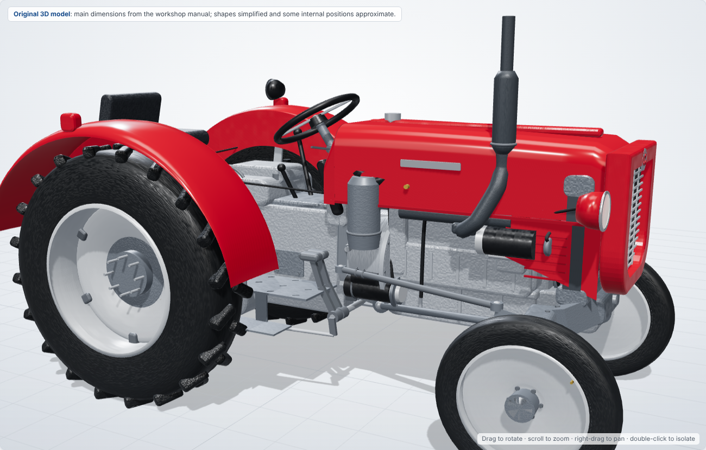
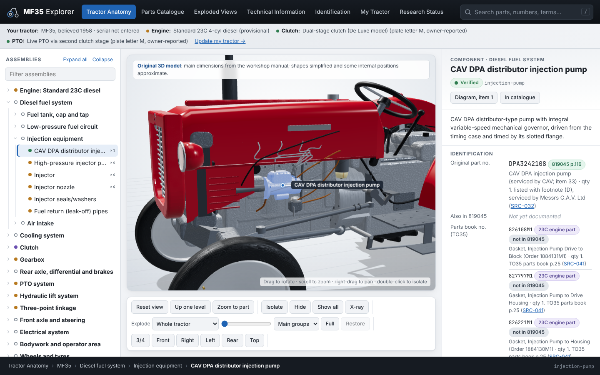
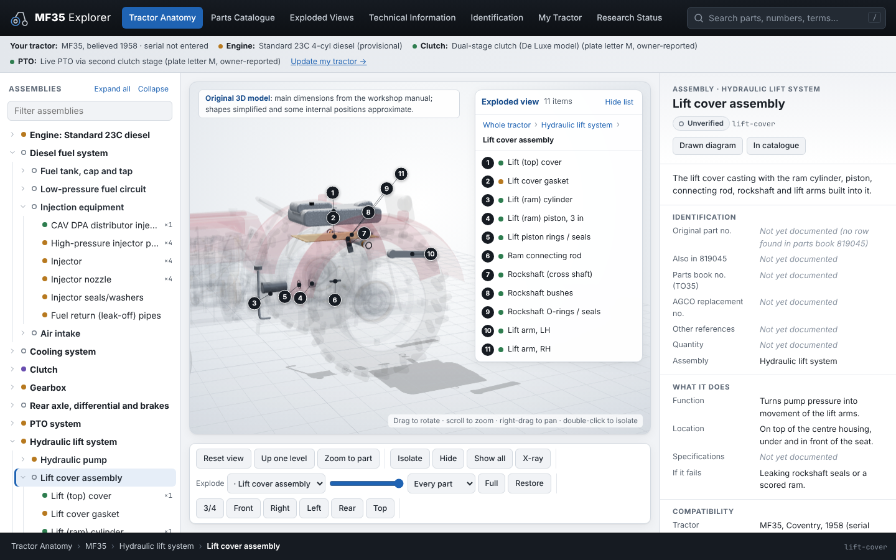
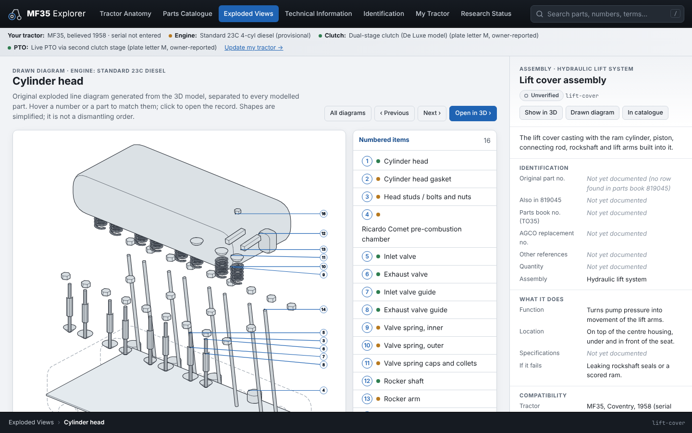

<div align="center">



# MF35 Explorer

**A complete digital 1958 Massey Ferguson 35 diesel on your workbench: rotate it, take it apart, click any part to see what it is, what it does, its original part number and where to buy one in the UK.**


[](LICENSE)

[What it is](#what-it-is) · [Hobby project](#a-hobby-project-offered-as-is) · [Check before you order](#check-before-you-order) · [Screenshots](#screenshots) · [Open the app](#open-the-app) · [Documents](#documents-and-data) · [Development](#development) · [Licence](#licence)

</div>

---

## What it is

**MF35 Explorer** is an interactive 3D anatomy, exploded parts catalogue and technical encyclopaedia for one
tractor: a **1958 Coventry-built Massey Ferguson 35 diesel** with the Standard 23C four-cylinder engine. It is
built from the AGCO MF35/35X parts book 819045, the FE35/MF35 workshop manual, the Ferguson TO35 parts book,
the 2008 AGCO Heritage catalogue, photographs and UK supplier listings, all cited record by record.

- **A 3D tractor made of separate parts.** Over 220 modelled parts in their real positions, each one clickable.
  Isolate, hide, X-ray, explode any assembly, and jump between the 3D view, the drawn diagram and the record.
- **Every part explained.** What it is, what it does, where it sits, what happens if it fails, and the parts it
  connects to.
- **Original part numbers.** 135 components carry their original number and quantity from the 1958 parts book,
  with later AGCO and TO35 numbers alongside. Where the book splits a part inside 1958, every candidate is listed.
- **UK purchase references.** Supplier listings matched to the original number, marked exact, AGCO reference,
  listed fit or check fit, with the price and stock seen on the date checked.
- **Technical information.** Sourced figures, torque settings, capacities, power-flow diagrams for the PTO and
  hydraulic lift, an identification guide for serial and engine numbers, and a glossary.
- **Honest about gaps.** Every record shows a verification status, and the Research Status page and completeness
  report list what is still missing.

## A hobby project, offered as-is

This is a hobby project, made for fun in spare time to understand and restore one tractor. It is offered as-is,
with no warranty, no support and no promised updates. There may be mistakes, and some may never be fixed. Issues
are turned off on this repository and I'm not able to answer questions, take requests or fix problems. You're
welcome to use it, learn from it and change it for your own use under the terms of the [MIT licence](LICENSE),
at your own risk. The "My Tractor" entries are saved in your browser only, so make a note of them elsewhere.

## Check before you order

> [!WARNING]
> **Some of the information here could be wrong. Please check before ordering anything.**
>
> - The part numbers, quantities and fitments were read from scanned parts books and manuals by a person and an AI
>   assistant, for one tractor, and have not been checked against the metal. A misread digit, a serial-number split
>   or a variant we don't know about can make a listed number wrong for your tractor.
> - Supplier prices, stock and fitment claims are what the supplier's page said on the date shown. They change.
>   A supplier's quoted OEM number is the supplier's claim, not a confirmation.
> - Only records marked **Verified** have been checked against an original Massey Ferguson publication, and even
>   those apply to the 1958 Coventry diesel with the Standard 23C engine, not to every MF35.
> - Confirm the part against your own serial number, engine number and the part in your hand, or with the
>   supplier, before you spend money. The app is a guide to finding the right part, not a guarantee.

## Screenshots

| Tractor Anatomy: a part selected, with its record | Exploded 3D view of the lift cover, with numbered items |
| --- | --- |
|  |  |

<details>
<summary><b>Drawn exploded diagram of the cylinder head</b></summary>



</details>

## Open the app

**Online:** **https://bigdaddy284.github.io/Massey-Ferguson-35-Explorer/** (published from `main` by the GitHub
Pages workflow in `.github/workflows/pages.yml`). It runs in any modern desktop, tablet or phone browser.

**Locally:** download or clone the repository and open `app/index.html` in a browser. It needs no server or
install. Alternatively, run `npm run serve` and visit http://localhost:8035.

## Documents and data

| Deliverable | Document | Data |
|---|---|---|
| Tractor specification | [docs/research/01-tractor-specification.md](docs/research/01-tractor-specification.md) | — |
| Research source register | [docs/research/02-source-register.md](docs/research/02-source-register.md) | [data/sources.json](data/sources.json) |
| Configuration & compatibility rules | [docs/research/03-configuration-rules.md](docs/research/03-configuration-rules.md) | [data/configurations.json](data/configurations.json) |
| Initial component hierarchy | [docs/research/04-component-hierarchy.md](docs/research/04-component-hierarchy.md) | [data/hierarchy.json](data/hierarchy.json) |
| Documentation, suppliers & 3D resources | [docs/research/05-documentation-and-modelling-resources.md](docs/research/05-documentation-and-modelling-resources.md) | — |
| AGCO Heritage 2008 replacement numbers | [docs/research/06-agco-heritage-2008.md](docs/research/06-agco-heritage-2008.md) | `replacementReferences` in [data/hierarchy.json](data/hierarchy.json) |
| UK suppliers | [docs/research/07-uk-suppliers.md](docs/research/07-uk-suppliers.md) | [data/suppliers.json](data/suppliers.json) |
| Completeness report | [docs/research/08-completeness-report.md](docs/research/08-completeness-report.md) | `npm run report` |
| Parts book 819045 method and page map | [docs/research/09-parts-book-819045.md](docs/research/09-parts-book-819045.md) | `partsBookReferences` (`book: 'MF35'`) |
| 3D model notes | [docs/model/README.md](docs/model/README.md) | `app/js/model.js` |

Specifications: [docs/spec/PRODUCT_SPEC.md](docs/spec/PRODUCT_SPEC.md) (governing) and
[docs/spec/DESIGN.md](docs/spec/DESIGN.md).

## Development

```bash
npm run build   # validate data/*.json and regenerate app/data/mf35-data.js
npm test        # core logic tests
npm run report  # rewrite the completeness report
npm run smoke   # browser check of every view at desktop, tablet and phone widths (needs Playwright)
```

Performance notes (Phase 9): the 3D view draws a frame only when something changes, and the page appears before the
model is built, so the interface is usable at once and idle tabs use almost no GPU.

## Accuracy policy

Nothing is shown as verified unless it has been checked against an original Massey Ferguson publication.
Supplier part numbers are recorded as claims until then. Every record carries its sources and a verification
status, and missing information always reads "Not yet documented" rather than being guessed. The rules are in
[CLAUDE.md](CLAUDE.md) under "Non-negotiable accuracy rules".

## Made with AI

MF35 Explorer was written with [Anthropic's Claude](https://claude.ai/code) as the coding assistant, working
from the owner's specification, photographs, parts books and workshop manual, and the owner's checking of the
results. The 3D model, the diagrams and all the text are original: nothing is copied from AGCO publications,
which were used only as references to read part numbers and dimensions from.

## Licence

Copyright © 2026 BigDaddy284.

MF35 Explorer is released under the **[MIT licence](LICENSE)**. In plain words: you can use, copy, change,
share and even sell it, as long as you keep the copyright and licence notice. It comes **without any
warranty**. [Three.js](https://threejs.org) (r147, in `app/vendor/three/`) is also MIT licensed, with its own
notice in that folder.

Massey Ferguson, Ferguson, Standard, CAV and the other names mentioned are trade marks of their owners. This
is an independent hobby reference and is not affiliated with or endorsed by AGCO or any supplier named in it.

---

<div align="center">

MF35 Explorer is provided "as is", without warranty of any kind. Check every part against your own tractor
before you buy. This summary isn't legal advice: the licence text linked above is what applies.

</div>
